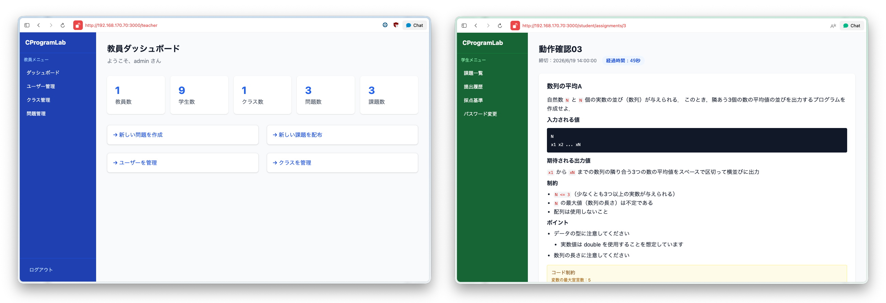

# C Programming Lab

C言語専用のプログラミング演習・自動採点プラットフォームです。
大学の授業（学生数十人規模）での使用を想定しており、学内サーバーで動作します。
学生はブラウザ上でC言語コードを記述・提出でき、即時に採点結果を確認できます。



## 機能概要

このシステムには **教員 / TA / 学生** の3種類のアカウントがあります。

### 教員
- ユーザー管理：教員・TAアカウントの作成・削除・パスワード管理
  - プライマリ管理者（初期 `admin` アカウント）のパスワードは本人のみ変更可能
  - 教員同士・TA同士は互いのパスワードを変更・削除不可（自分自身のパスワードは常に変更可能）
  - TAアカウントの作成・削除は教員のみ
- クラス・学生の管理（個別追加 / CSV一括インポート）
- 問題の作成・編集（テストケース・サンプルケース・コード制約（上限・下限）の設定、Markdown問題文でのLaTeX数式表示に対応）
  - テストケース・サンプルケースへの添付ファイル（`.txt` / `.csv`、1ケースあたり複数可）に対応。プログラムがファイルを開いて処理する問題も作成可能（標準入出力のみの問題もそのまま利用可）
- 関数定義型の問題（ハーネス方式）：学生は指定された関数だけを書き、教員が用意した非公開の `main`（ハーネス）が呼び出して採点。初期コード（雛形）の配布、模範解答による「動作確認」にも対応
- 問題データの JSON インポート / エクスポート（1問1ファイル、添付ファイルを含む）
- 課題の配布（公開開始日時・締切日時に加え、解答開始期限を任意で設定可能）
- 課題の編集（タイトル・公開期間・解答開始期限の変更）
- 採点結果の一覧表示・CSV エクスポート（全提出履歴 / 学生ごとの最新スコアのみ・未提出者を含む）・提出コード閲覧・ZIP ダウンロード

### TA（教員より権限の低い補助アカウント）
- 全クラスの学生一覧・提出状況・採点結果の閲覧（CSV / ZIP エクスポート含む）
- 問題内容の閲覧（問題文・コード制約・サンプルケース・テストケースを含む。閲覧のみ）
- 学生アカウントのパスワードリセット（対象は学生のみ）
- 問題・クラス・ユーザーの作成・編集・削除は不可（アカウントの作成・削除は教員のみ）

### 学生
- ブラウザ上での C 言語コード記述・提出（Monaco Editor、数式付き問題文の表示に対応）
- 関数定義型の問題では `main` を書かずに関数だけを実装（初期コードが表示される）
- サンプル実行（提出前に動作確認、採点には影響しない）
- 即時採点結果・点数内訳の確認
- 解答時間の計測（「開始する」を押した時刻からサーバー側で記録）
- 課題に解答開始期限が設定されている場合、期限を過ぎて未開始のままだと解答できない
- 再提出（締切前かつ、全テストケース正解・減点なしの満点に達するまでは何度でも提出可能）
- 提出履歴の閲覧
- 採点基準ページの参照

## 技術スタック

| 区分 | 技術 |
|---|---|
| フロントエンド | Next.js 15（App Router）、TypeScript、Tailwind CSS、Monaco Editor、KaTeX（数式表示） |
| バックエンド | FastAPI（Python 3.12）、SQLAlchemy、Pydantic v2 |
| データベース | SQLite（`backend/data/cprogramlab.db`） |
| ジャッジエンジン | Docker + gcc 14（C言語のみ、サンドボックス実行） |
| 認証 | セッションベース（itsdangerous） |

## 採点基準

各課題は **100点満点** で採点されます。

```
合計点 = 正解点(50) + 全問正解ボーナス(20) + 時間点(30) − 減点
```

| 項目 | 点数 | 内容 |
|---|---|---|
| 正解点 | 最大50点 | テストケース正解数に比例（passed/total × 50） |
| 全問正解ボーナス | 20点 | 全テストケース合格時のみ加算 |
| 時間点 | 最大30点 | 開始から3分ごとに1点減点、90分以上で0点 |

**減点項目**（問題ごとに制約がある場合のみ適用）

| 条件 | 減点 |
|---|---|
| コンパイル警告あり | −20点 |
| 変数・配列・ポインタ数が制約から外れた（上限超過・下限不足） | 各 −20点 |
| ループ文・if文数が制約から外れた（上限超過・下限不足） | 各 −10点 |

全テストケース正解・減点なしの満点（100点）に達した場合、その課題は再提出できなくなります。

詳細は [RUBRIC.md](./RUBRIC.md) を参照してください。

## ディレクトリ構成

```
CProgramLab/
├── frontend/          # Next.js 15
├── backend/           # FastAPI
├── judge/             # ジャッジ用 Docker イメージ（gcc 14）
├── .devcontainer/     # Claude Code / 開発用コンテナ
├── docker-compose.yml
├── CLAUDE.md          # Claude Code 向けプロジェクト指示書
└── RUBRIC.md          # 採点基準の仕様書
```

## セットアップ・起動

### 前提条件

- Docker・Docker Compose がインストールされていること
- ジャッジ用イメージのビルドが完了していること（下記参照）

### ジャッジ用イメージのビルド（初回のみ）

```bash
docker build -t cprogramlab-judge:latest ./judge
```

### アプリの起動

```bash
# 環境変数ファイルの作成（SECRET_KEY は本番環境では必ず変更すること）
echo "SECRET_KEY=your-secret-key-here" > .env

# ビルドと起動
docker compose up -d backend frontend

# 動作確認
docker compose ps
```

起動後、ブラウザで `http://<サーバーIP>:3000` にアクセスしてください。

### 初期アカウント

| ユーザー名 | パスワード | 権限 |
|---|---|---|
| `admin` | `admin` | 教員（プライマリ管理者） |

> **注意**：初回ログイン後は必ずパスワードを変更してください。

TA・教員アカウントは、教員でログイン後「ユーザー管理」画面から追加作成できます（学生アカウントはクラス管理画面から作成）。

### アプリの停止

```bash
docker compose down
```

データベース（`backend_data` volume）はコンテナを停止しても保持されます。
データも含めて完全に削除する場合は `docker compose down -v` を使用してください。

---

## 開発者向け情報

### Claude Code 開発環境の起動

このリポジトリは Claude Code を使って開発されています。
開発用コンテナを使用する場合は以下の手順に従ってください。

```bash
# UID/GID を合わせる（初回のみ）
echo "DOCKER_UID=$(id -u)" >> .env
echo "DOCKER_GID=$(id -g)" >> .env

# 開発用コンテナのビルドと起動
DOCKER_UID=$(id -u) DOCKER_GID=$(id -g) docker compose build dev
docker compose up -d dev

# コンテナへ入る
docker compose exec dev bash
```

コンテナ内で Claude Code を起動します。

```bash
claude
```

### API エンドポイント一覧

バックエンドの API ドキュメント（Swagger UI）は起動後に以下の URL で確認できます。

```
http://localhost:8000/docs
```

主なエンドポイント：

| メソッド | パス | 概要 |
|---|---|---|
| POST | `/api/v1/auth/login` | ログイン |
| GET | `/api/v1/problems` | 問題一覧 |
| POST | `/api/v1/problems/import` | 問題インポート |
| POST | `/api/v1/problems/{id}/verify` | 模範解答でテストケースを実行して動作確認（教員用。関数定義型のハーネス検証に使用） |
| GET | `/api/v1/assignments` | 課題一覧 |
| POST | `/api/v1/assignments/{id}/start` | 課題開始（開始時刻を記録） |
| POST | `/api/v1/submissions` | コード提出・採点（満点提出済みの場合は再提出を拒否） |
| POST | `/api/v1/submissions/run` | サンプル実行 |
| GET | `/api/v1/results/summary` | 採点結果一覧 |
| GET | `/api/v1/results/csv` | 採点結果CSV（全提出履歴） |
| GET | `/api/v1/results/csv/latest` | 採点結果CSV（学生ごとの最新スコアのみ、未提出者を含む） |
| PUT | `/api/v1/users/{id}/reset_password` | パスワードリセット（教員・TA用。TAは学生のみ対象） |

### 環境変数

| 変数名 | デフォルト値 | 説明 |
|---|---|---|
| `SECRET_KEY` | `dev-secret-key-change-in-production` | セッション署名キー（本番環境では変更必須） |
| `JUDGE_TMPDIR` | `/var/lib/cprogramlab/judge-tmp` | ジャッジ一時ファイルのディレクトリ（`/tmp` 以下は systemd により定期削除されるため使用不可） |
| `BACKEND_URL` | `http://backend:8000` | フロントエンドからバックエンドへのURL |

> **注意**：`JUDGE_TMPDIR` は必ず `/tmp` 以外を指定してください。Ubuntu の `systemd-tmpfiles-clean.timer`（`/usr/lib/tmpfiles.d/tmp.conf` の `q /tmp ... 10d` ルール）により、`/tmp` 以下は10日間アクセスがないと自動削除されます。この削除が起きるとbackendコンテナとホスト間のバインドマウントが無効になり、採点・サンプル実行が全て失敗します（過去に実際に発生した障害です）。

### ジャッジの仕組み

1. 学生のコードを一時ファイルに書き出す（`JUDGE_TMPDIR` 以下）
2. テストケース・サンプルケースに添付ファイル（`.txt` / `.csv`）がある場合、実行前にソース・実行ファイルと同じディレクトリに配置（前のケースの添付ファイルは実行前にクリア）
3. `cplab-{uuid}` という名前の Docker コンテナを起動（`cprogramlab-judge:latest` イメージ）
4. コンテナ内でコンパイル・実行（関数定義型の問題は、学生コードとハーネスを別々にコンパイルしてリンクし、ハーネスのソース・オブジェクトは削除してから実行）（タイムアウト：5秒/テストケース）。判定は標準出力の比較のみ
5. タイムアウト時は `docker kill` でコンテナを強制終了
6. ソースコードを静的解析してコード制約をチェック
7. 点数を計算して結果を DB に保存

セキュリティのため、ジャッジコンテナは非 root ユーザー（`sandbox`）で実行されます。

---

## サンプルデータ

`samples/` ディレクトリに、初期セットアップや動作確認に使えるサンプルデータを用意しています。

```
samples/
├── problems/   # サンプル問題（JSON形式、問題管理ページからインポート可能）。カテゴリごとにディレクトリを分け、模範解答は各カテゴリの solutions/ に置く
│   ├── 01_基本入出力/   # 2問
│   ├── 02_関数・配列・文字列・再帰/   # 5問
│   ├── 03_ポインタ/   # 10問
│   ├── 04_構造体/   # 6問
│   ├── 05_連結リストと動的メモリ/   # 4問
│   ├── 06_数学関数（math.h）/   # 7問
│   ├── 07_標準ライブラリ（stdlib.h）/   # 4問
│   │   （各カテゴリ配下に solutions/ があり、模範解答 .c を置く）
└── users/      # 学生一括登録用のCSVひな形
    └── students.csv
```

### サンプル問題（`samples/problems/`）

教員の問題管理ページ（「インポート」ボタン）から読み込めます。各ファイルは1問1ファイルの JSON 形式です。`problem_*.json` はプログラム型、`function_*.json` は**関数定義型**（`problem_type: "function"`。学生が書く関数の雛形 `template_code` と、非公開の `main`＝`harness_code` を含む）です。各カテゴリの `solutions/` の模範解答は、問題編集ページの「動作確認」に貼り付けて検証できます。

#### 01_基本入出力

標準入出力・for文の基礎（プログラム型）

| ファイル | 問題タイトル | テストケース | サンプルケース |
|---|---|---|---|
| `problem_1_for文の使い方.json` | for文の使い方 | 5件 | 2件 |
| `problem_2_scanfとprintfの使い方.json` | scanfとprintfの使い方 | 5件 | 2件 |

#### 02_関数・配列・文字列・再帰

関数定義型の入門。値渡し・配列・文字列・再帰

| ファイル | 問題タイトル | テストケース | サンプルケース |
|---|---|---|---|
| `function_1_max2.json` | 【関数】2つの整数の大きい方 | 8件 | 2件 |
| `function_3_average.json` | 【関数】配列の平均値 | 8件 | 2件 |
| `function_4_count_char.json` | 【関数】文字列中の文字の個数 | 12件 | 2件 |
| `function_5_reverse_string.json` | 【関数】文字列を反転する | 10件 | 2件 |
| `function_7_factorial.json` | 【関数】階乗（再帰関数） | 8件 | 2件 |

#### 03_ポインタ

ポインタ変数・ポインタ渡し・ポインタ演算・ポインタを返す関数（`problem_3` は下限不足で提出拒否、`problem_4` は減点）

| ファイル | 問題タイトル | テストケース | サンプルケース |
|---|---|---|---|
| `problem_3_ポインタ変数で和と積.json` | ポインタ変数で和と積を求める | 8件 | 2件 |
| `problem_4_ポインタで配列の合計.json` | ポインタで配列をたどって合計を求める | 8件 | 2件 |
| `function_2_swap.json` | 【関数】ポインタで2つの値を交換 | 6件 | 2件 |
| `function_16_double_value.json` | 【関数】ポインタ先の値を2倍にする | 8件 | 2件 |
| `function_17_div_mod.json` | 【関数】商と余りを同時に返す（出力用ポインタ） | 8件 | 2件 |
| `function_18_min_max.json` | 【関数】配列の最小値と最大値 | 10件 | 2件 |
| `function_19_sum_range.json` | 【関数】ポインタで範囲を指定して合計（ポインタ演算） | 10件 | 2件 |
| `function_20_my_strlen.json` | 【関数】文字列の長さ（ポインタでたどる） | 8件 | 2件 |
| `function_21_find_char.json` | 【関数】文字を探してポインタを返す | 14件 | 2件 |
| `function_22_max_element.json` | 【関数】最大要素へのポインタを返す | 10件 | 2件 |

#### 04_構造体

構造体の値渡し・ポインタ渡し・配列・戻り値

| ファイル | 問題タイトル | テストケース | サンプルケース |
|---|---|---|---|
| `function_6_point_distance.json` | 【関数】2点間の距離（構造体） | 8件 | 2件 |
| `function_8_rect_info.json` | 【関数】長方形の面積と周の長さ（構造体のポインタ） | 8件 | 2件 |
| `function_9_move_scale.json` | 【関数】点の移動と拡大（構造体のポインタ） | 8件 | 2件 |
| `function_10_find_best.json` | 【関数】最高得点の学生（構造体の配列） | 8件 | 2件 |
| `function_11_sort_students.json` | 【関数】得点順に並べ替え（構造体の配列） | 8件 | 2件 |
| `function_14_add_fraction.json` | 【関数】分数の足し算（構造体を返す関数） | 10件 | 2件 |

#### 05_連結リストと動的メモリ

連結リスト、`malloc` による動的確保

| ファイル | 問題タイトル | テストケース | サンプルケース |
|---|---|---|---|
| `problem_14_動的配列malloc.json` | 要素数が実行時に決まる配列（malloc） | 10件 | 2件 |
| `function_12_list_sum.json` | 【関数】連結リストの合計（構造体とポインタ） | 9件 | 2件 |
| `function_13_list_reverse.json` | 【関数】連結リストの反転（ポインタのつなぎ替え） | 8件 | 2件 |
| `function_15_repeat_string.json` | 【関数】文字列をn回繰り返す（動的メモリ確保） | 8件 | 2件 |

#### 06_数学関数（math.h）

`pow`・`sqrt`・`hypot`/`atan2`・`floor`/`ceil`/`round`・`log10`。`-lm` でリンクされる。`-std=c99` のため `M_PI` は使えず、問題文で `acos(-1.0)` を案内している

| ファイル | 問題タイトル | テストケース | サンプルケース |
|---|---|---|---|
| `problem_5_複利計算.json` | 複利計算（pow） | 8件 | 2件 |
| `problem_6_二次方程式の解.json` | 二次方程式の解（sqrt） | 12件 | 2件 |
| `problem_7_極座標への変換.json` | 直交座標から極座標への変換（hypot・atan2） | 10件 | 2件 |
| `problem_8_切り上げ切り捨て四捨五入.json` | 切り捨て・切り上げ・四捨五入（floor・ceil・round） | 15件 | 2件 |
| `problem_9_整数の桁数.json` | 整数の桁数（log10） | 13件 | 2件 |
| `function_23_is_perfect_square.json` | 【関数】平方数かどうかの判定（sqrt） | 14件 | 2件 |
| `function_24_round_digits.json` | 【関数】小数第d位で四捨五入（pow・round） | 14件 | 2件 |

#### 07_標準ライブラリ（stdlib.h）

`strtol`・`div`・`qsort`

| ファイル | 問題タイトル | テストケース | サンプルケース |
|---|---|---|---|
| `problem_10_進数文字列の変換.json` | n進数の文字列を整数に変換する（strtol） | 11件 | 2件 |
| `problem_11_商と余りdiv.json` | 商と余りを求める（div） | 12件 | 2件 |
| `problem_12_qsortで降順.json` | 整数を降順に並べ替える（qsort） | 10件 | 2件 |
| `problem_13_qsortで辞書順.json` | 文字列を辞書順に並べ替える（qsortとstrcmp） | 10件 | 2件 |

### 学生一括登録用CSV（`samples/users/`）

クラス管理ページの「CSVインポート」機能で使用できます。1行目はヘッダー行（`username,password`）で、2行目以降に1学生1行で記述します。

```csv
username,password
student01,pass01
student02,pass02
```

> **注意**：サンプル CSV のパスワードはそのまま使用しないでください。実際の運用時は安全なパスワードに変更してください。
